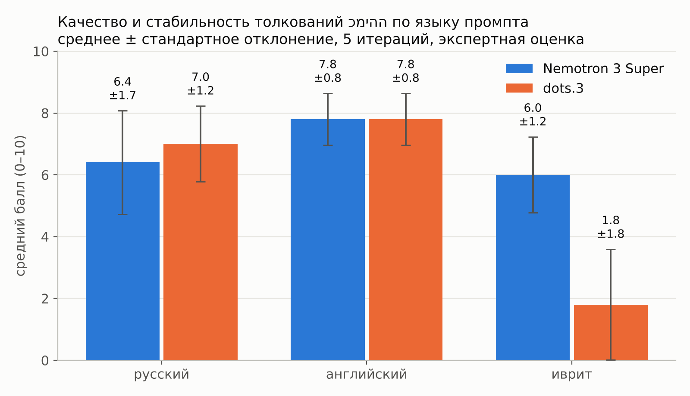

# Томление на языке примитивов: умеют ли LLM толковать ключевое слово культуры по методу NSM

Финальный проект курса «Введение в промпт-инжиниринг» (НИУ ВШЭ).

Языковые модели получают 24 реальных контекста ивритского слова **כמיהה** («томление») из корпуса и должны составить его толкование
на естественном семантическом метаязыке (NSM, А. Вежбицкая), используя только 65 семантических примитивов.
Промпт подаётся на трёх языках — русском, английском и иврите; 2 модели × 3 языка × 5 итераций = 30 толкований.
Толкования оценены вслепую по шкале из 5 критериев (0–10 баллов).

**Гипотеза:** слово живёт сразу в нескольких сферах (религия, нация, эрос, психология), которые подпитывают друг друга;
хорошее толкование должно это схватить, а качество толкования зависит от языка промпта.

## Главные результаты

| Модель | Язык промпта | n | Среднее | SD | Отказы / сломанные |
|---|---|---|---|---|---|
| Nemotron3 | en | 5 | 7.8 | 0.84 | 0 / 0 |
| Nemotron3 | he | 5 | 6.0 | 1.23 | 0 / 0 |
| Nemotron3 | ru | 5 | 6.4 | 1.67 | 0 / 1 |
| Dots3 | en | 5 | 7.8 | 0.84 | 0 / 0 |
| Dots3 | he | 5 | 1.8 | 1.79 | 1 / 5 |
| Dots3 | ru | 5 | 7.0 | 1.23 | 0 / 2 |

- Язык промпта значим (Kruskal–Wallis, p = 0,001): лучше всего английский, хуже всего иврит.
- На иврите модели расходятся: Nemotron3 держит качество (6,0), Dots3 проваливается (1,8; Mann–Whitney p = 0,011) —
  отвечает по-английски, с иероглифами, один раз отказывается.
- Самый трудный критерий — К3 (отличие от געגועים и תשוקה), самый лёгкий — К4 (сферы).
- В корпусе (20 415 контекстов, NMF, 10 тем → 5 сфер) **42% контекстов смешивают две сферы и больше**, чаще всего нацию и психологию.



## Структура

```
data/        исходные и промежуточные данные
results/     все метрики и статистика (CSV)
figures/     графики и схемы (PNG, SVG)
notebooks/   Colab-ноутбуки: эксперимент через OpenRouter и тематическое моделирование
prompts/     промпты на трёх языках: шаблоны и полные тексты
db/          база данных SQLite (публичная версия) + её копия в Excel + схема
report/      презентация, текст выступления, финальная таблица оценок
scripts/     скрипты, которыми собраны таблицы, графики и база
```

### data/
| Файл | Что внутри |
|---|---|
| `contexts_24.csv` | 24 контекста из корпуса, вошедшие в промпт |
| `primes_ru_en_he.csv` | 65 семантических примитивов на русском, английском и иврите |
| `models.csv` | 5 моделей-кандидатов, ID на OpenRouter, причины отсева |
| `rubric.csv` | шкала оценивания: критерии К1–К5 и описание 0/1/2 |
| `model_responses.json` | 30 сырых ответов моделей |
| `responses_long.csv` | ответы в табличном виде: сферы, толкование, число строк |
| `blind_key.csv` | ключ слепой оценки: код ответа → модель, язык, итерация |
| `scores_wide.csv` | оценки К1–К5 и итог, одна строка на ответ |
| `scores_long.csv` | те же оценки в длинном формате + кто ставил и пояснение к К1 |
| `context_spheres.csv` | веса пяти сфер для каждого контекста корпуса (без текстов) |

### results/
| Файл | Метрика |
|---|---|
| `summary_model_lang.csv` | n, среднее, SD, коэффициент вариации, мин/медиана/макс, отказы — по модели × языку |
| `by_model.csv`, `by_language.csv` | то же в разрезе модели и языка |
| `by_criterion.csv`, `criterion_overall.csv` | средние по каждому критерию |
| `stat_tests.csv` | Kruskal–Wallis (язык), Mann–Whitney (модели), Spearman (длина vs оценка) |
| `consistency_lexical.csv` | стабильность между итерациями: средний коэффициент Жаккара по словам толкования и по сферам |
| `explication_length.csv` | длина толкований: строки, слова, число названных сфер |
| `script_drift.csv` | доля иврита / кириллицы / латиницы / иероглифов в каждом толковании |
| `k1_out_of_list_words.csv` | слова вне списка примитивов, найденные проверкой К1 |
| `failures.csv` | статусы ответов (ok / отказ / сломанный формат) |
| `pilot_empty_answers.csv` | пустые ответы пробного прогона — причина доработки протокола |
| `sphere_coverage_by_model_lang.csv` | какие сферы модели называют в ответе |
| `topics_nmf10.csv` | 10 тем корпуса: метка, сфера, доля, топ-слова |
| `topic_coherence_by_k.csv` | когерентность NPMI для K = 8…18 — обоснование выбора K = 10 |
| `sphere_shares.csv` | доля контекстов, где сфера ведущая |
| `sphere_mixing.csv` | сколько сфер одновременно присутствует в контексте |
| `sphere_pairs.csv` | какие пары сфер встречаются вместе |
| `sphere_by_source.csv` | профиль сфер у крупных источников корпуса |

### figures/
`design` и `prompt_structure` — схемы дизайна эксперимента и структуры промпта;
`fig_mean_sd`, `fig_scores_by_iteration`, `fig_criteria_heatmap`, `fig_criteria_bars`, `fig_cv`, `fig_consistency`,
`fig_length_vs_score`, `fig_script_drift`, `fig_k1_words` — результаты эксперимента;
`fig_topics`, `fig_topic_coherence`, `fig_sphere_mixing`, `fig_sphere_pairs`, `fig_sphere_by_source` — корпус.

## Протокол

- Доступ: OpenRouter API из Google Colab — одна точка доступа и одинаковые параметры для всех моделей, бесплатные версии моделей.
- Модели: `nvidia/nemotron-3-super-120b-a12b:free` (NVIDIA, США), `dots-studio/dots-3-note-preview:free` (Xiaohongshu, Китай); отсеяны Gemma 4, Inkling, Xing 4 (см. `data/models.csv`).
- temperature 0,7; max_tokens 16 000; пауза 5 с; пустой ответ повторяется один раз.
- Оценка: К1 (только примитивы) — автоматическая проверка (лемматизация pymorphy3 для русского, снятие префиксов для иврита) + ручная проверка;
  К2–К5 — экспертная оценка вслепую по коду ответа.
- Тематическое моделирование: TF-IDF + NMF, K выбран по NPMI, 10 тем сведены в 5 сфер.

## Как воспроизвести

1. Открыть `notebooks/kmiha_nsm_experiment.ipynb` в Colab, вставить свой ключ OpenRouter, запустить ячейки по порядку.
2. Пересчитать таблицы и графики из готовых данных:
   ```
   pip install -r requirements.txt
   python scripts/build_metrics.py <папка проекта> .
   python scripts/build_figures.py .
   ```

## Корпус

Полный корпус (≈ 20 000 контекстов с израильских сайтов) в репозиторий не выложен из-за авторских прав на тексты.
Здесь есть 24 контекста из промпта, идентификаторы и источники всех контекстов, их тематические веса и агрегаты.
В публичной базе таблица `corpus` заменена на `corpus_meta` без текстов; `scripts/build_db.py`, `tm_prep.py` и `tm_model.py`
требуют полного корпуса.
